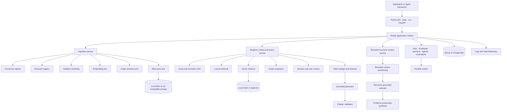

# Refaat

**The Python-native evidence and context foundation for reliable AI systems.**

## Meaning

**R**etrieval<br>
**E**vidence<br>
**F**oundation for<br>
**A**daptive<br>
**A**gentic<br>
**T**ooling

> **REFAAT — Retrieval & Evidence Foundation for Adaptive Agentic Tooling**

Refaat is an open-source Python runtime from **Oronts** for building grounded AI applications without rebuilding ingestion, hybrid retrieval, knowledge graphs, semantic caching, citations, memory, evaluations, durable jobs, and observability for every agent framework.

It unifies **RAG**, **GraphRAG**, **CAG**, **KAG**, bounded recursive language-model execution, durable agents, executable skills, and evidence-backed adaptation behind one typed runtime.

> Release status: `0.1.0` is a production-oriented foundation release. The complete offline path runs without a paid model and is covered by unit, integration, failure-injection, worker, API, SDK, RLM, migration, and package smoke tests. Production deployments still require organization-specific capacity, threat-model, model-provider, backup, and compliance validation.

## Why Refaat exists

AI teams repeatedly rebuild the same infrastructure around LangChain, LlamaIndex, CrewAI, custom agents, and direct model SDKs:

- document parsing and idempotent ingestion;
- embeddings, lexical search, vector search, and graph expansion;
- context ranking, deduplication, diversity, and token budgeting;
- exact and semantic answer caches;
- evidence identifiers and validated citations;
- user memory, session compaction, and long-running goals;
- evaluations, feedback, adaptation, and rollback;
- jobs, schedules, leases, retries, heartbeats, and agent messaging;
- model, storage, connector, framework, and telemetry adapters.

Refaat owns these stable semantics. Agent frameworks and model vendors remain replaceable adapters.

## What Refaat is

Refaat is a modular runtime with several public surfaces:

- a typed synchronous Python API;
- a high-level `RefaatProject` developer experience;
- a typed synchronous and asynchronous HTTP SDK;
- a FastAPI service;
- a command-line interface;
- a durable worker process;
- entry-point plugins and executable Python skills;
- thin LangChain, LlamaIndex, and CrewAI integrations.

Refaat is not a chain DSL, a hosted model, or a general-purpose code sandbox. It does not hide evidence behind framework-specific objects and does not allow a model to rewrite its immutable grounding policy.

### Pluggable by design

Every model, storage, retrieval, connector, chunking, and framework seam is a typed Protocol port. `src/refaat/ports.py` defines more than two dozen ports, the runtime builder exposes about 35 `with_*` injection points, and five entry-point groups (`refaat.skills`, `refaat.extractors`, `refaat.connectors`, `refaat.event_sinks`, `refaat.chunkers`) let a third-party distribution register an adapter, gated by an allowlist and optional content-hash pins. Model vendors and agent frameworks are adapters, so the dependency flows into the runtime rather than the other way around. The built-in defaults are byte-identical, and an unresolvable adapter refuses startup instead of degrading silently.

## Everything is programmatic

```python
from pathlib import Path

from refaat import Refaat, RlmLimits

with Refaat() as runtime:
    project = runtime.project(
        workspace="oronts",
        corpus="engineering",
    )

    project.ingest(Path("./documents"))

    answer = project.ask(
        "What controls are required before production deployment?",
        user_id="developer-42",
    )

    recursive = project.rlm(
        "Compare release, security, and incident requirements.",
        user_id="developer-42",
        limits=RlmLimits(
            max_depth=3,
            max_nodes=16,
            branch_factor=4,
            leaf_token_budget=1_500,
        ),
    )

    print(answer.answer)
    print(answer.citations)
    print(recursive.usage)
```

The zero-configuration development path uses SQLite, secure local blobs, deterministic embeddings, lexical retrieval, deterministic graph extraction, and grounded extractive generation. Production adapters can switch to PostgreSQL/pgvector, S3-compatible storage, Redis, OpenAI-compatible model endpoints, and OpenTelemetry without changing application code.

## One runtime for RAG, CAG, KAG, and GraphRAG

| Capability | Refaat behavior |
|---|---|
| RAG | Lexical and semantic retrieval over versioned chunks |
| GraphRAG | Entity and relation extraction, graph expansion, and graph-aware ranking |
| CAG | Exact and semantic grounded-answer caching with strict isolation keys |
| KAG | Graph facts, skills, session state, persistent goals, user preferences, and harness state |
| Adaptive context | Query planning, fusion, deduplication, diversity, token packing, and route selection |
| Grounding | Stable chunk identities, canonical citations, quote extraction, and citation validation |
| RLM | Bounded recursive decomposition over externalized corpus context with preserved evidence IDs |

A cache entry is isolated by workspace, corpus version, user or session scope, retrieval policy, and active harness state. Replacing or deleting a document advances the corpus version, which prevents an old answer from becoming a valid cache hit for changed evidence.

## Architecture



The repository is a **modular monolith with separate API, worker, and migration process roles**. This preserves one domain model and one composition root while allowing the API and worker to scale independently. It avoids premature internal microservices and keeps retrieval semantics identical across the Python API, HTTP API, SDKs, CLI, jobs, and integrations.

## Core capabilities

### Ingestion and multimodal evidence

- idempotent document replacement keyed by `source_id`;
- content checksums and monotonically increasing corpus versions;
- original-document persistence before canonical indexing;
- compensating rollback across SQL, search index, and blob storage;
- text, Markdown, JSON, JSONL, CSV, HTML, PDF, DOCX, and source-code extraction;
- optional image OCR and audio transcription adapters;
- pluggable chunking through a typed strategy port, with built-in flat, parent-child, and sentence-window strategies and configurable overlap;
- deterministic or OpenAI-compatible embeddings;
- deterministic co-occurrence or schema-validated model graph extraction;
- local file, HTTP, HTTPS, and plugin connector contracts;
- file-root confinement, byte limits, blocked redirects, and SSRF controls;
- default exclusion of hidden files, virtual environments, build output, dependencies, and VCS metadata.

### Adaptive retrieval and context

- lexical and semantic candidate retrieval;
- graph-derived document boosts and graph facts;
- normalized retrieval weights;
- weighted semantic, lexical, graph, and profile fusion;
- document diversity penalties;
- explicit context token budgets;
- oversized-chunk truncation;
- bounded user preference signals learned only from explicit feedback;
- persistent session summaries with automatic compaction;
- exact and semantic cache lookup before generation;
- stable evidence IDs and validated citations after generation.

### Bounded recursive language-model execution

Refaat includes a real recursive-context primitive for questions whose corpus is larger than one model context window:

1. Keep the complete corpus outside the model context.
2. Rank and partition evidence under explicit token and branch budgets.
3. Run bounded recursive subproblems.
4. carry sub-results and original chunk identifiers into synthesis;
5. validate the final citations against canonical corpus chunks;
6. record node traces, depth, call counts, token counts, routes, and fallbacks.

The caller controls `max_depth`, `max_nodes`, `branch_factor`, and `leaf_token_budget`. The core does **not** execute arbitrary model-generated host code. Trusted executable behavior belongs in reviewed skills and plugins.

```bash
refaat rlm <workspace-id> <corpus-id> \
  "Compare all production controls" \
  --max-depth 3 \
  --max-nodes 16 \
  --branch-factor 4 \
  --leaf-token-budget 1500
```

Add `--background` to create a durable `rlm.run` job processed by the worker.

### Durable agents and long-running work

- persistent sessions and goals;
- automatic turn compaction with retained recent context;
- leased background jobs;
- worker heartbeats and lease recovery;
- retry scheduling and terminal failures;
- interval schedules;
- retained parent and subagent records;
- direct agent-to-agent mailboxes;
- message acknowledgement;
- transactional outbox records and at-least-once publishing;
- synchronous and background evaluations;
- durable RLM runs.

Refaat provides durable coordination primitives. Application policy still decides which tools an agent may call, when autonomous work may continue, and which operations require human approval.

### Evidence-backed harness improvement

The immutable base grounding prompt is hash-locked. It cannot be rewritten by an agent.

Refaat can instead create immutable supplemental harness snapshots from recorded evaluation evidence. Only allowlisted fields can change, including bounded retrieval weights, `top_k`, answer style, and an instruction suffix. Activation is explicit and auditable, and any prior snapshot can be restored.

This gives the harness a safe improvement loop:

```text
evaluation → metrics → bounded proposal → immutable snapshot → explicit activation → rollback
```

### Executable skills and plugins

Skills are importable Python packages, not prompt fragments. A skill receives a prepared `ContextPacket` and typed JSON arguments. The built-in creator generates a clean package skeleton:

```bash
refaat skill create release_review "Review release evidence and controls"
```

Third-party distributions can register:

```toml
[project.entry-points."refaat.skills"]
release_review = "company_refaat_skills.release:ReleaseReviewSkill"

[project.entry-points."refaat.extractors"]
confluence_export = "company_refaat_extractors:ConfluenceExtractor"

[project.entry-points."refaat.connectors"]
company_wiki = "company_refaat_connectors:CompanyWikiConnector"

[project.entry-points."refaat.event_sinks"]
audit = "company_refaat_events:AuditSink"

[project.entry-points."refaat.chunkers"]
semantic = "company_refaat_chunkers:SemanticChunker"
```

`REFAAT_PLUGIN_ALLOWLIST` contains approved entry-point names; an empty list disables automatic third-party discovery. Plugins and skills are trusted application code and must be reviewed, pinned, and deployed like any other production dependency.

### Authorization and multi-tenancy

Refaat enforces per-principal access control over every evidence path: retrieval (including HyPE and RAPTOR), graph facts, RLM recursion, citations, the answer cache, session memory, learned preferences, and every program and HTTP surface. It is the enforcement layer, not the identity provider: a deployment brings its own identity through a `PrincipalResolver` and its own policy through an `AccessPolicy`, and can route the decision to an external engine such as OPA or Cedar behind the same contract.

```python
from refaat.domain.authz import CanonicalAccessPolicy, HeaderPrincipalResolver, Principal

runtime = (
    RuntimeBuilder(settings)
    .with_access_policy(CanonicalAccessPolicy())
    .with_principal_resolver(HeaderPrincipalResolver())
    .build()
)
alice = Principal(id="alice", tenant="acme", groups=frozenset({"finance"}))
answer = runtime.project(workspace="acme", corpus="handbook").ask("rollback policy?", principal=alice)
```

Authorization is byte-identical when unconfigured and fail closed when active: an untagged or malformed evidence unit is denied, a cross-tenant request is refused by a framework pre-policy guard even under a custom policy, the HTTP surface never trusts a client-supplied identity, and a model never decides a permission. Evidence is tagged at ingestion with an `acl` block (classification plus allow and deny lists and tenant), and the permission travels source to document to chunk to graph fact to retrieval to citation. See [Authorization](docs/authorization.md), [Access and multi-tenancy](docs/access-and-multitenancy.md), [Identity lifecycle](docs/identity-lifecycle.md), and [Audit and provenance](docs/audit-and-provenance.md).

### Enterprise governance and assurance

Authorization anchors a wider governance layer, each piece a typed plugin that is byte-identical when unconfigured and fail closed when active. Tool use is governed: a governed ReAct trajectory admits a tool only within the caller's scopes and side-effect ceiling, and a sensitive tool sits behind a durable, single-use, four-eyes approval whose fingerprint is bound to the program artifact so any change to the program, its policy, or its skills forces re-approval. Generation is governed: a deterministic classifier refuses to send over-classified evidence to a model, and output governance and generation-evidence egress redaction constrain what an answer may carry off the evidence boundary. Every served query and RLM run emits a redacted-by-construction audit event through a durable at-least-once outbox, with an opt-in fail-closed policy that refuses rather than serve unaudited.

Data lifecycle and operations are first class: right to erasure, legal holds that record every ACL re-tag of a held document in an append-only permission-history ledger with the old and new fingerprint and the attributed actor, and incident kill switches, execution-time secrets that never enter an artifact or a cache key, per-principal and per-workspace quotas with a read-only admin status plane, and graceful degradation that returns an honest, clearly-degraded answer on a provider outage instead of failing or fabricating. Untrusted retrieved evidence stays in a data role that can never become an instruction, and an executable skill or plugin is admitted only at a pinned, content-verified identity.

Delivery is assured by the quality gate: an API-compatibility baseline, a migration-safety analyzer, a committed SBOM and dependency policy, release provenance and out-of-band signing, an executable threat model with a coverage gate, a vulnerability-process allowlist, and an offline performance-regression benchmark, composed into a documented production release gate.

See [Tool governance](docs/tool-governance.md), [Approvals](docs/approvals.md), [Right to erasure](docs/erasure.md), [Legal holds](docs/legal-holds.md), [Kill switches](docs/kill-switches.md), [Quotas](docs/quotas.md), [Admin status plane](docs/admin-status.md), [Execution-time secrets](docs/execution-time-secrets.md), [Output governance](docs/output-governance.md), [Data-classification model routing](docs/model-routing.md), [Degradation](docs/degradation.md), [Plugin pinning](docs/plugin-pinning.md), [Injection posture](docs/injection-posture.md), [Threat model](docs/security/threat-model.md), [Supply chain and SBOM](docs/reference/supply-chain.md), [Performance benchmarks](docs/reference/benchmarks.md), and the [Release gate](docs/operations/release.md).

## Five-minute local start

Requirements: Python 3.12 or 3.13 and `uv`.

```bash
cp .env.example .env
uv sync --extra dev --extra documents
uv run refaat init --slug demo --name "Demo workspace"
```

The command prints the first administrator API key once. Then:

```bash
uv run refaat corpus create <workspace-id> handbook
uv run refaat ingest <workspace-id> <corpus-id> examples/data/company/02_release_policy.md
uv run refaat query \
  <workspace-id> \
  <corpus-id> \
  "What is required before a production deployment?"
```

Run the programmatic example:

```bash
uv run python examples/01_local_rag_graph_cache.py
```

## Runnable product examples

The repository ships a catalog of self-asserting workflows that use temporary real databases, blobs, workers, and HTTP processes rather than mocks:

| Script | Complete workflow |
|---|---|
| `01_local_rag_graph_cache.py` | Local RAG, GraphRAG, CAG, replacement, and cache invalidation |
| `02_sessions_feedback.py` | Session compaction, goals, feedback, and user-specific ranking |
| `03_rlm_agents_jobs.py` | Bounded RLM, direct agent messages, durable jobs, and restart persistence |
| `04_evaluations_harness.py` | Regression metrics, bounded proposals, snapshots, activation, and rollback |
| `05_programmatic_extensions.py` | Custom connector, extractor, skill, event sink, and outbox delivery |
| `06_live_api_sdk.py` | Real Uvicorn server with synchronous and asynchronous SDKs |
| `07_cli_workflow.py` | Persistent CLI workflow across independent processes |
| `08_framework_integrations.py` | Framework-neutral, CrewAI, LangChain, and LlamaIndex adapters |
| `09_typed_program.py` | Typed programs: signatures, content-addressed artifacts, grounded execution |
| `10_program_evaluation.py` | Native evaluation: content-addressed datasets, metrics, and bundles |
| `11_program_optimization.py` | Deterministic retrieval-policy optimization: candidate search and ranking |
| `12_program_registry.py` | Durable registry: content-addressed artifacts, promotion, and atomic rollback |
| `13_durable_evaluation.py` | Program evaluation as a durable background worker job |
| `14_full_rag_gauntlet.py` | Full-library gauntlet across ingestion, retrieval, programs, and optimization |
| `15_program_as_skill_trajectory.py` | A promoted program as a governed tool, scored with a trajectory bundle |
| `16_reference_app.py` | The whole library end to end over one corpus, with LangChain and LangGraph |
| `17_durable_optimization.py` | Checkpointed, resumable optimization, byte-identical to synchronous optimize() |
| `18_showcase_rag.py` | Oronts showcase: the full retrieval feature set over Oronts content, offline and deterministic |
| `19_governed_fine_tuning.py` | Approval-gated, provenance-tracked fine-tuning that never auto-promotes |
| `20_multimodal_generation.py` | An image ingested as one citable descriptor chunk, with vision-model generation |
| `21_sandboxed_code_rlm.py` | Deny-by-default governed code execution inside the bounded RLM |
| `22_authorization_aware_evidence.py` | Per-principal ACL isolation across retrieval, citations, and the answer body, with a no-policy control |
| `23_governed_tool_approval.py` | A sensitive tool gated behind a durable, single-use, four-eyes approval |
| `24_governed_model_routing.py` | A classification-ceiling router refusing to send over-classified evidence to the model |
| `26_audit_and_provenance.py` | A redacted-by-construction audit event per served query, inline and via the durable outbox |
| `27_durable_job_freshness.py` | A durable RLM job's identity snapshot re-resolved at execution, admitting when fresh and refusing when scope changed |
| `28_enterprise_governance.py` | Authorization, classification-ceiling routing, and redacted audit composed on one governed runtime |
| `29_custom_chunking_strategy.py` | A custom chunking strategy injected through the typed port, with contextual embedding, HyPE, and RAPTOR composing on it |

Run all of them:

```bash
PYTHONPATH=src python scripts/examples_check.py
```

See [`docs/examples.md`](docs/examples.md) for the behavior and expected output of each journey.

## FastAPI and HTTP SDK

Start the API:

```bash
uv run refaat-api
```

Bootstrap the first workspace:

```bash
curl -sS http://localhost:8000/v1/bootstrap/workspaces \
  -H 'Content-Type: application/json' \
  -H "X-Bootstrap-Token: $REFAAT_BOOTSTRAP_TOKEN" \
  -d '{"slug":"acme","name":"Acme"}'
```

All non-bootstrap endpoints accept `Authorization: Bearer <api-key>` or `X-API-Key`. Keys are scoped to one workspace and carry `read`, `write`, and/or `admin` scopes.

```python
from refaat.sdk import RefaatClient

with RefaatClient("http://localhost:8000", api_key) as client:
    corpus = client.create_corpus("engineering")
    client.ingest_text(
        corpus["id"],
        source_id="release.md",
        title="Release policy",
        content="Production releases require review and rollback evidence.",
    )

    answer = client.query(
        corpus["id"],
        "What does a production release require?",
    )

    recursive = client.run_rlm(
        corpus["id"],
        "Compare the complete release policy.",
        max_depth=2,
        max_nodes=12,
    )
```

`AsyncRefaatClient` exposes the equivalent asynchronous query, retrieval, source-ingestion, RLM, and job operations.

## Framework integrations

```python
from refaat.integrations import as_langchain_retriever
from refaat.sdk import RefaatClient

client = RefaatClient("https://refaat.example.com", api_key)
retriever = as_langchain_retriever(client, corpus_id, top_k=8)
documents = retriever.invoke("How does release approval work?")
```

Equivalent adapters exist for LlamaIndex and CrewAI-style tools. Integrations translate framework-native objects only. Ranking, tenancy, memory, cache isolation, graph expansion, citations, and persistence stay inside Refaat.

## Production composition

The supplied Compose stack includes:

- PostgreSQL with pgvector;
- password-protected Redis;
- SeaweedFS with an authenticated, pre-created S3 bucket;
- an explicit Alembic migration process;
- separately scalable API and worker processes;
- an optional OpenTelemetry Collector.

```bash
cp deploy/compose.env.example .env.compose
set -a
. ./.env.compose
set +a
docker compose up --build
```

The image is multi-stage and runs as a non-root user. The service containers use a read-only root filesystem, dropped Linux capabilities, `no-new-privileges`, health probes, an isolated backend network, an explicit application egress network, and explicit secrets.

A Helm chart under [`deploy/helm/refaat`](deploy/helm/refaat) provides separate deployments, a migration hook, probes, pod security contexts, disruption budgets, optional autoscaling, optional ingress, optional network policies, and externally managed secret references.

## Security model

The implemented baseline includes:

- workspace isolation on storage and API operations;
- scrypt-hashed API keys with a server-side pepper;
- constant-time credential verification;
- explicit API scopes;
- trusted-host and CORS controls;
- request-size limits and rate limiting;
- Redis coordination for distributed API rate limiting;
- request and trace IDs;
- production-safe error envelopes;
- local path confinement and connector byte limits;
- blocked connector credentials and redirects;
- private/reserved-host blocking for outbound connectors;
- user- and session-scoped personalized caches;
- audit/outbox events;
- production configuration validation;
- secret scanning and dependency-audit gates;
- non-root containers and hardened Kubernetes defaults.

Read [`docs/security.md`](docs/security.md) before deployment. Refaat is a foundation, not a substitute for an organization-specific threat model, data-classification policy, encryption-key design, network egress controls, model-provider agreement, or incident process.

## Observability

Structured logs include request and workspace context. Optional OpenTelemetry integration instruments:

- FastAPI requests;
- SQLAlchemy operations;
- outbound HTTPX model and connector requests;
- OTLP trace export.

```env
REFAAT_OTEL_ENABLED=true
REFAAT_OTEL_SERVICE_NAME=refaat
REFAAT_OTEL_EXPORTER_ENDPOINT=http://otel-collector:4317
```

## Repository layout

```text
src/refaat/
├── domain/          canonical models and invariants
├── core/            chunking, retrieval, grounding, learning, compaction
├── application/     ingestion, query, RLM, evaluations, agents, worker
├── infrastructure/  SQL, pgvector, blobs, connectors, models, graph, events
├── api/             FastAPI transport, schemas, middleware, dependencies
├── sdk/             synchronous and asynchronous HTTP clients
├── integrations/    thin LangChain, LlamaIndex, and CrewAI adapters
├── skills/          executable skills, registry, and creator
├── cli.py           command-line interface
└── worker.py        worker process entry point
```

API, worker, migration, CLI, SDK-backed integrations, and programmatic use all resolve through the same application services. There is no second retrieval implementation hidden in an adapter.

## Quality and release evidence

Run the complete local gate:

```bash
./scripts/quality.sh
```

The gate records machine-readable statuses and raw logs for:

- dependency availability;
- bytecode compilation;
- source-style invariants;
- AST-based unused-import, duplicate-body, and unreachable-code audit;
- static Compose, shared-image, Helm-schema, lifecycle, and shell validation;
- execution of every self-asserting product example in the catalog;
- committed OpenAPI drift and cross-surface version consistency;
- Ruff formatting and linting when installed;
- strict mypy when installed;
- committed-secret scanning;
- unit, integration, failure-injection, worker, API, SDK, and RLM tests;
- branch-aware coverage with an 80% minimum;
- Alembic migration smoke testing;
- documentation links and navigation;
- strict MkDocs build when installed;
- wheel and source-distribution creation;
- distribution content verification, including docs, examples, tests, migrations, deployment assets, and CI in the source archive;
- clean wheel extraction and full programmatic smoke test;
- PostgreSQL/pgvector, dependency audit, Docker, Compose, and Helm when the host provides them.

Unavailable host capabilities receive exit code `125`; they are never displayed as passing. Dedicated CI jobs provide PostgreSQL/pgvector, container, Compose, Helm, CodeQL, and dependency-update coverage.

See [`docs/testing.md`](docs/testing.md) and the generated `QUALITY_REPORT.md` after a release-gate run.

## Common commands

```bash
refaat init
refaat doctor
refaat corpus create
refaat corpus list
refaat ingest
refaat ingest-source
refaat query
refaat rlm
refaat evaluation create
refaat evaluation run
refaat skill list
refaat skill create
refaat worker
refaat serve
```

## Documentation

- [Getting started](docs/getting-started.md)
- [Runnable examples](docs/examples.md)
- [Python API reference](docs/reference/python-api.md)
- [HTTP API and OpenAPI](docs/reference/http-api.md)
- [CLI reference](docs/reference/cli.md)
- [Product boundary](docs/product-boundary.md)
- [Architecture](docs/architecture.md)
- [Adaptive RAG, CAG, KAG, and GraphRAG](docs/adaptive-context.md)
- [Bounded RLM and autonomy](docs/rlm-and-autonomy.md)
- [Ingestion and multimodal extraction](docs/ingestion.md)
- [Connectors and plugins](docs/connectors.md)
- [Custom chunking strategies](docs/guides/custom-chunking.md)
- [Durable agents and long-running work](docs/agents-and-jobs.md)
- [Harness learning and rollback](docs/harness.md)
- [Evaluations](docs/evaluations.md)
- [Typed programs](docs/programs.md)
- [Program evaluation](docs/program-evaluation.md)
- [Program optimization](docs/program-optimization.md)
- [Program registry and promotion](docs/program-registry.md)
- [Agentic tools and governed ReAct](docs/agentic-tools.md)
- [Model providers](docs/providers.md)
- [Reranking](docs/reranking.md)
- [Streaming](docs/streaming.md)
- [Model-call cache and budgeting](docs/model-cache.md)
- [Multimodal generation](docs/multimodal.md)
- [Governed fine-tuning](docs/fine-tuning.md)
- [Sandboxed-code RLM](docs/sandboxed-rlm.md)
- [Framework integrations](docs/framework-integrations.md)
- [Enterprise foundation](docs/enterprise-foundation.md)
- [Authorization](docs/authorization.md)
- [Execution-time secrets](docs/execution-time-secrets.md)
- [Access and multi-tenancy](docs/access-and-multitenancy.md)
- [Identity lifecycle](docs/identity-lifecycle.md)
- [Audit and provenance](docs/audit-and-provenance.md)
- [Data-classification model routing](docs/model-routing.md)
- [Learning and preferences](docs/learning-and-preferences.md)
- [API and SDK](docs/api-and-sdk.md)
- [Security](docs/security.md)
- [Configuration](docs/configuration.md)
- [Deployment](docs/deployment.md)
- [Production checklist](docs/production-checklist.md)
- [Testing and release evidence](docs/testing.md)
- [Operations and observability](docs/operations.md)
- [Backup and restore](docs/operations/backup-restore.md)
- [Threat model](docs/security/threat-model.md)

## Brand architecture

```text
Oronts
└── Refaat
    ├── Refaat open-source Python runtime
    ├── Refaat Studio
    ├── Refaat Enterprise
    └── Refaat Cloud
```

The distribution, import, CLI, environment namespace, images, and deployment resources consistently use `refaat` or `REFAAT_*`.

The project name is not presented as completed legal trademark clearance. Perform package-name, trademark, and jurisdiction-specific checks before a commercial public launch.

## Contributing and security

Read [`CONTRIBUTING.md`](CONTRIBUTING.md), [`CODE_OF_CONDUCT.md`](CODE_OF_CONDUCT.md), and [`SECURITY.md`](SECURITY.md). Security reports should follow the private disclosure path documented there rather than a public issue.

## License

Apache License 2.0. See [`LICENSE`](LICENSE).
