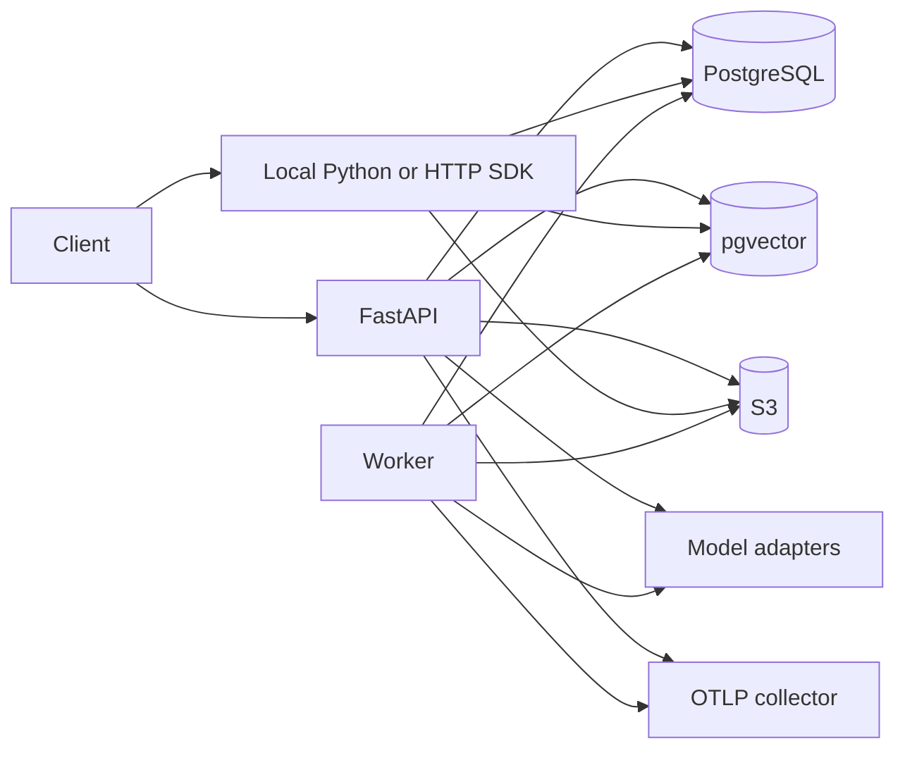

# Architecture

## Product boundary

Refaat owns evidence, context, grounding, durability, and evaluation semantics. Application-specific business logic,
user interfaces, approval policy, model hosting, and unrestricted tool execution remain outside the core.

## Deployable topology

API, worker, migration, CLI, and local project API use one package and composition root. They can scale independently
without duplicating retrieval or authorization semantics.

## Layers

1. **Domain** defines immutable documents, chunks, graph values, requests, answers, citations, RLM limits, and traces.
2. **Core** provides deterministic chunking, fusion, budgeting, citation validation, compaction, learning, and harness
   constraints.
3. **Application** coordinates ingestion, query, recursive context, evaluations, agents, and durable work.
4. **Ports** define replaceable storage, model, graph, connector, extractor, event, clock, and skill contracts.
5. **Infrastructure** implements SQL, local/pgvector search, blob stores, models, extractors, connectors, plugins,
   events, and telemetry.
6. **Surfaces** expose Python, FastAPI, sync/async SDKs, CLI, worker, skills, and framework adapters.

Dependencies point inward. Framework objects and provider payloads never become canonical domain values.

## Consistency model

The relational store is authoritative. Ingestion stages derived index state and then commits canonical document, chunk,
graph, and corpus-version rows. Because SQL, vector search, and object storage cannot share one atomic transaction,
failures trigger compensating restoration of the prior index and deletion of staged blobs. Retained embeddings allow
index repair.

Caches include corpus version and identity/session scope, so document changes invalidate old answers without scanning
all cache rows. The outbox is durable and delivered at least once; consumers and handlers must be idempotent.

## Recursive context model

RLM runs use externalized canonical chunks. The service ranks and partitions evidence, bounds depth/nodes/branching,
performs grounded child calls, and synthesizes from child results while preserving original chunk IDs. It does not add an
unrestricted Python REPL to the trusted core.

## Scaling boundary

SQLite and deterministic local search support development, CI, edge, and small private corpora. PostgreSQL/pgvector
performs database-side retrieval for multi-process production. A corpus uses one embedding model and dimension at a
time; migration means rebuilding a new index version and evaluating it.

Cache correctness is defined by [ADR 0005](adr/0005-effective-context-cache-fingerprint.md). Programmatic extension contracts are documented in [Custom extensions](guides/custom-extensions.md).
